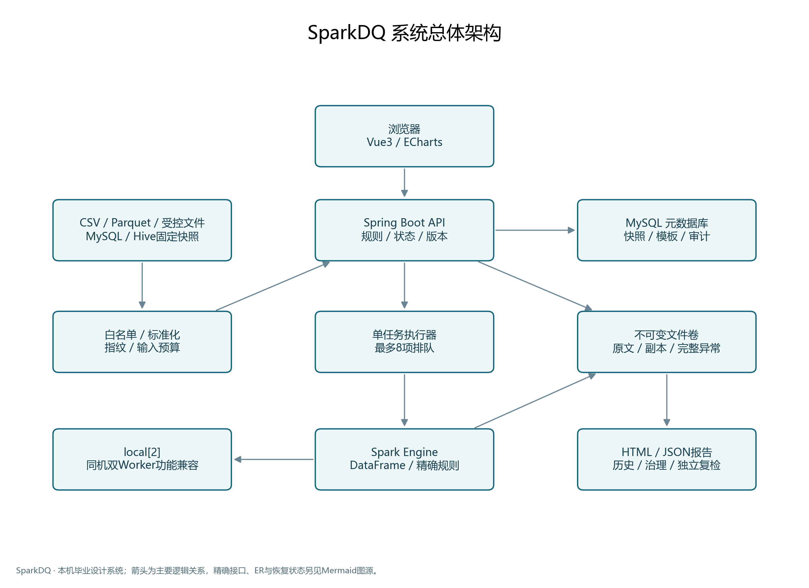
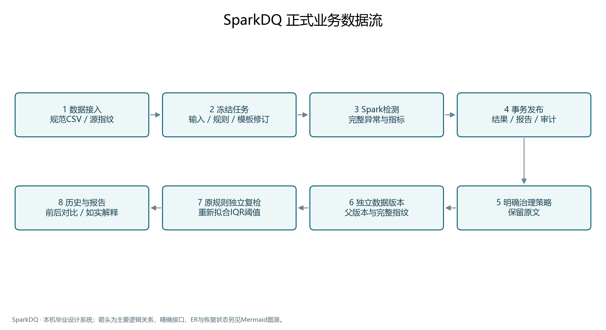
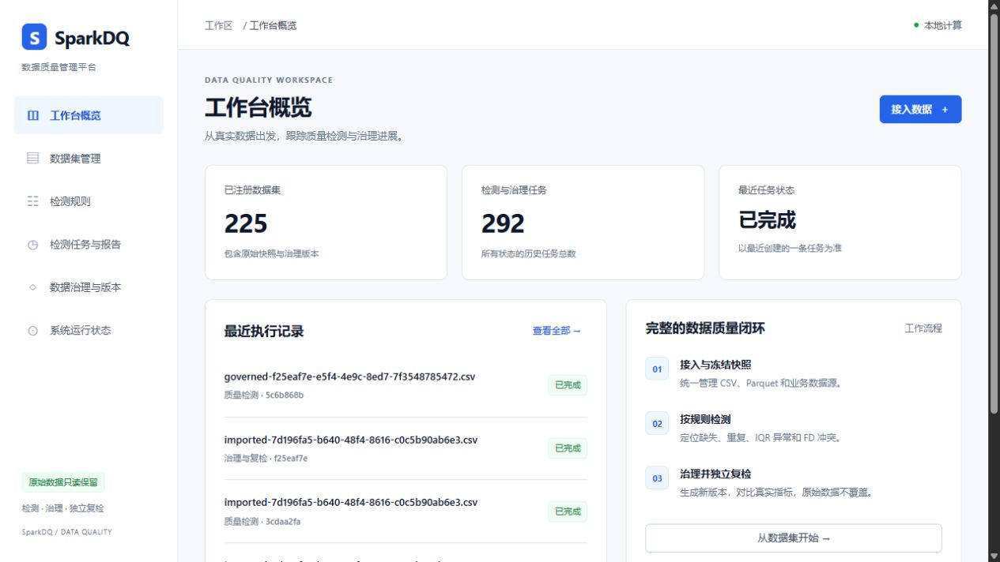

# SparkDQ · 数据质量检测与治理

基于 Spark 的毕业设计：将数据接入、质量检测、治理、独立版本、复检和报告连接成可追溯的工作流。

SparkDQ is a graduation project for reproducible data quality checks and governance with Apache Spark, Spring Boot and Vue. It preserves source files and produces independent governed versions and auditable reports.

适合学习 Java 后端与 Spark 的集成，以及使用合成数据体验质量治理。按显式业务规则检测问题，不使用机器学习模型，不自动判断业务冲突中哪条记录是真实值。

## 当前状态

公开发布候选基于正式源码 `044d0df025c546ae254400d882ae704d8d98ad1e`，补充公开部署、演示验收与文档，并修正刷新按钮事件绑定，不修改业务算法。历史资料保留各自日期和版本，不能当作本次重新执行的结果。

- 默认公开配置采用 Spark `local[2]`，不需要企业数据库、外部 Spark 集群或 Hive。
- 普通导入预算 20 MiB；多分片、原生 Parquet、MySQL 业务快照和受控导入另有配置与边界。
- 历史同机双 Worker 验证是 Standalone 功能兼容，不是跨物理机验证或加速保证。
- 历史 500 万行属于受控离线实验，不是 500 万行全产品闭环。本次公开演示使用 14 行合成数据。
- 历史 Hive 验收为真实 SerDe 表、持久 Catalog、管理员有界导出后固定快照接入；快速开始不部署 Hive。
- 面向本机学习演示，无多租户认证和企业公网生产安全承诺，端口仅绑定回环地址。

## 架构与核心工程设计



Vue 通过同源 `/api` 请求 Spring Boot。后端管理数据集、规则模板、任务状态和治理审计，以独立 Java 进程调用 Spark 引擎，避免 Spring Boot 与 Spark 的依赖冲突。MySQL 保存元数据，文件卷保存原始输入、执行快照、完整异常与结果证据。

冻结输入与规则修订、输入 SHA-256、单任务执行与有界排队、取消与失败处理、治理新版本及独立复检构成主要工程设计。治理保留原文并记录操作与行数变化。仓库包含备份与隔离恢复工具，公开首次启动不依赖私有备份。



## 技术栈

|组件|源码锁定版本/方式|
|---|---|
|Java / Maven|Java 17；Maven 3.9.12 构建镜像，固定摘要|
|Spring Boot / Flyway|3.5.16 / BOM 管理的 11.7.2|
|Spark / Scala|3.5.8 / `_2.12` 制品|
|MySQL / Connector/J|8.4.8 / 8.4.0|
|Node / Vue / Vite|22.22.0 / 3.5.44 / 7.3.7|
|ECharts|5.6.0，依赖告警与使用限制见[版本说明](docs/versions.md)|
|部署|Docker Engine 与 Compose 插件；Flyway 从空库初始化|

以 pom.xml、frontend/package-lock.json 和镜像摘要为准。容器完成 Java/Node 构建，宿主无需另装 JDK、Maven 或 Node。

## 检测算法

|规则|实际含义|
|---|---|
|缺失值|分别统计 NULL、空字符串、普通纯空格与合计|
|精确重复|按业务键分组：重复组是组大小>1的组；涉及重复行包括组内全部行；超额重复为各重复组的大小减1之和|
|IQR|排序有效十进制数，以 `(n−1)p` 线性插值求 Q1/Q3；`IQR=Q3−Q1`；严格小于 `Q1−k×IQR` 或大于 `Q3+k×IQR` 才异常，边界相等正常；默认 k=1.5|
|函数依赖 FD|显式配置 X→Y；同 X 下不同 Y 元组超过1个即冲突，返回组内全部参与行，包括多数派与重复行|
|其他|类型、数值范围、正则整字段匹配|

IQR 精确十进制域最多28位整数、10位小数；非法、空白、超域输入分别计数跳过。少于4个有效值不作正常结论，零 IQR 仍按严格边界判断。每次复检重新拟合阈值，异常数下降不等于修复。FD 比较原始文本，不自动去空格、合并大小写或发现依赖；参与字段为空白则跳过。冲突参与行不是确定的错误来源。见[IQR](docs/iqr.md)、[FD](docs/fd.md)。

## 快速开始

在 Windows 11 的 WSL2 Linux shell 或兼容 Linux shell 中操作。需要运行中的 Docker Engine/支持 Linux 容器的 Docker Desktop、Compose 插件和 Python 3；需要下载 Docker Hub、Maven Central、npm 依赖。取得公开仓库源码并进入根目录：

```bash
git clone https://github.com/Uni4907/spark-dq.git
cd spark-dq
python3 infrastructure/init_env.py
docker compose up -d --build
docker compose ps
```

第一步生成两组随机密码，已有 .env 会保留。不要直接使用 .env.example 占位符。首次构建可能需要数分钟；MySQL 健康后后端执行迁移，前端启动不表示后端已经就绪。

打开 <http://127.0.0.1:15180>，健康接口 <http://127.0.0.1:18090/api/health>。MySQL 不发布宿主端口。端口占用时在 .env 添加 `WEB_PORT=15181`、`API_PORT=18091`。

根目录 compose.yaml 为公开入口。infrastructure/compose.yaml、dev.sh、demo.py 属于历史环境工具，不用于本快速开始。尚未声明最低 CPU/内存/磁盘要求：后端堆上限512 MiB、Spark子进程堆上限1 GiB，数据库、构建和系统另需资源；不能把堆上限相加当作最低机器内存。实际环境及验证边界见[本次验收](docs/public-release-validation.md)。

## 演示闭环

`demo/orders.csv` 是14行合成订单，含缺失备注、重复业务键、金额离群和 code→category 冲突。规则与策略见 demo/rules.json、demo/governance.json。

1. 在“数据接入”上传 demo/orders.csv，选择新数据集。
2. 到“检测规则”：空值字段只选 note，重复业务键只选 id。
3. 添加 IQR：amount，k=1.5；添加 FD：决定项 code，依赖项 category。
4. 输入方式用“原始 CSV”，开始检测，在任务页等待“已完成”，点击“预览异常”。
5. 配置治理：只给 note 缺失值填充“待核实”，启用业务键去重，其余策略关闭。提交后查看新版本及操作审计。
6. 点击“按原规则复检治理版本”，等待独立任务完成。
7. 查看前后统计、版本来源和 HTML / JSON 报告；原文件仍可下载。

首次预期：缺失备注5行；重复2组/涉及4行/超额2行；IQR异常1行；FD冲突1组/参与4行。治理产生独立12行版本，备注缺失与重复消除；金额异常和FD冲突仍保留，策略没有自动修复它们。各规则可能命中同一行，不能相加为异常记录总数。完整阈值与复检结果以报告为准。

可选自动验收会新增合成数据和任务，仅对演示实例执行：

```bash
python3 tests/public_demo.py --base http://127.0.0.1:18090/api --output .runtime/public-demo-check
```

## 停止、保留与清理

```bash
docker compose stop
docker compose start
```

正常停止保留卷，start 启动原容器。保留 .env；修改配置密码不会同步更新已有数据库密码。`docker compose down` 移除本项目容器和网络，命名卷仍保留。

**删除数据需单独决定：** `docker compose down -v` 会删除本项目数据库和文件卷，无备份时不可恢复。仅在确认项目身份且确实要丢弃全部演示数据时手动执行，不属于正常停止。

|问题|处理|
|---|---|
|页面暂时无法连接|看 compose ps，等待数据库健康与迁移；查看 docker compose logs --tail 100 backend，分享日志前脱敏|
|下载失败|检查 Docker Hub、Maven Central、npm 访问条件，保留失败输出再重试|
|端口占用|修改 .env 的 WEB_PORT/API_PORT|
|默认网段池耗尽|保留已有网络，为此演示配置经检查无冲突的 Compose IPAM 网段；不执行全局 prune|
|上传或任务失败|核对大小、编码和字段，查看任务错误；保留原始输入与失败证据|
|治理后仍异常|策略只填备注、去重；IQR不自动裁剪，复检会重新拟合|

## 真实界面

工作台截图来自历史验收环境，用于展示桌面布局；其中数据集与任务数量属于历史环境，不代表新部署后的初始状态。下方治理报告来自本次独立空库部署及合成数据演示。



[实际治理报告长截图](docs/screenshots/governance-report.jpg)展示14行到12行、缺失填充、去重及保留的IQR/FD异常；它不是性能基准。

## 目录

```text
backend/          Spring Boot API、任务管理、Flyway迁移及测试
spark-engine/     Spark检测、治理、执行副本与引擎测试
frontend/         Vue工作区及测试
demo/             合成输入、规则、治理策略
infrastructure/   Dockerfile、部署及历史隔离验收工具
tests/            接口验收、独立oracle与夹具
docs/             算法契约、架构图、实验与发布验收
compose.yaml      无私有备份依赖的公开演示入口
```

## 测试、实验与技术取舍

[本次公开发布验收](docs/public-release-validation.md)分别记录可部署、可体验、可理解的执行结论。[历史算法实验](docs/algorithm-experiments.md)、[规模实验](docs/current-status-t4-t5-2026-10-21.md)、[公开数据实验](docs/public-data-experiments.md)各自限定版本、资源和数据口径。本次不重跑历史性能实验，不声称 Spark 在所有规模上都快于单机。

单任务本机演示不提供 HA、生产并发或跨主机迁移保证。Vite preview 仅用于演示；企业部署另需认证、网络与运维设计。可配置的数据源不等于任意数据库、格式或 Hive 查询均已验收。

## 许可

项目源码按 [Apache-2.0](LICENSE) 许可发布，作者已确认具备公开与许可授权且学校规定无冲突。第三方组件保留各自许可与通知要求，见[许可核查](docs/public-license-review.md)。不分发私有数据库备份、运行卷或真实业务原始数据。
