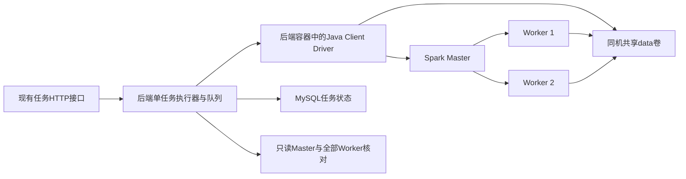

# 受控同机Standalone API执行

## 当前架构

本阶段将现有HTTP任务接口接到受控Standalone Client执行，限定同一Docker主机、一个PID 1后端JVM和固定Master/Worker集合。主服务没有切换，真实验收在此前从备份恢复且已停止的独立副本进行。没有改动网页表单；本轮验证的是网页所调用的HTTP接口，未进行集群模式浏览器交互验收。



Engine把自身jar分发给Executor，固定单Executor 1 core/768MiB、最多2 cores、动态分配关闭，资源注册最多等待30秒。准备执行副本和原生Parquet转换仍为本地Spark，避免将未完成的准备进程远程化。Worker派生镜像固定官方Spark3.5.8摘要，仅为共享卷建立UID1000账号；它与后端使用同UID写文件，不采用全盘放宽权限。

## 受信配置

仅管理员进程环境启用，不接受HTTP请求中的地址、命令或网络参数。默认local；未显式启用standalone却设置远程master时拒绝启动。

```yaml
SPARK_DQ_EXECUTION: standalone
SPARK_MASTER: spark://master:7077
SPARK_DQ_DRIVER_HOST: driver
SPARK_DQ_MASTER_JSON_URL: http://master:8080/json/
SPARK_DQ_WORKER_JSON_URLS: http://worker1:8081/json/,http://worker2:8081/json/
SPARK_INPUT_PARTITIONS: 8
SPARK_SHUFFLE_PARTITIONS: 2
```

Worker端点允许1..4个，不允许重复；URL不得带凭证、查询或片段，路径固定/json/。GET禁用代理和重定向，限制响应2MiB、连接/读取超时和整体读取预算。端点绝不从任务回执或上传数据获取。Driver使用后端容器driver网络别名，所有节点必须同网可见，/data路径必须共享。实验Master/Worker无发布端口；API仅绑定127.0.0.1。复用了专用恢复副本的网络，不连接主网络，也不修改Docker地址池。

SPARK_DQ_TASK_TIMEOUT_SECONDS默认为300，可由管理员设5..300。预算仍包括准备和检测；超时不是直接写FAILED，而是先停止本容器拥有的Driver并核对远程资源。

支持的恢复单元是整个后端容器：Java必须为PID 1，退出后由Docker结束其进程树。没有实现容器内任意第二JVM热重启、多个后端副本、跨物理机进程所有权、生产认证或HA。

## 持久状态与清理门禁

执行前在任务目录以create-only方式保存cluster-intent.json，包含任务ID、配置指纹、master和时间；Engine沿用上阶段的提交/启动/结束回执。确认清理后保存cluster-cleanup.json。所有记录随files卷持久化，无新增数据库表或版本迁移，数据库仍V5。

确认条件：本地Driver及观察到的子进程都已退出；回执/配置指纹有效；Master为ALIVE且活动节点集合与配置一致；Master活动作业与所有Worker活动Executor均不存在目标唯一名称或applicationId；两次清空观察至少间隔1秒。无法访问、陌生Worker、ID冲突、配置变化或损坏证据都不确认。无提交回执的受控尝试意味着Engine尚未进入Spark初始化；此时不补造applicationId。

正常成功在清理核对后才进行业务结果事务；取消维持CANCELLING，直到核对通过才CANCELLED；失败/超时未确认清理时保留RUNNING和错误原因，后台重试核对后才FAILED。恢复扫描只处理原来未结束的任务：取消中的任务清理后CANCELLED，其他中断任务清理后FAILED，不采用磁盘result文件推断成功。

集群清理待确认时，新任务拒绝409；此前已排队的任务等待前序清理，不启动新的Driver。维护/备份仍按数据库活动状态拒绝准入。恢复时若配置不匹配或切回local，远程意图不会被静默当作本地任务清理。

任务详情增加clusterExecution，反映登记的集群意图和最近清理观察；没有集群意图的历史/未启动任务返回local默认值，不能据此声称该任务已经执行。CLEAR是固定拓扑下记录的清空观察，不是通用分布式故障证明。Master历史中的FINISHED、Driver COMPLETED和业务SUCCEEDED保持各自含义；Executor真实退出在验收中另用Docker进程检查交叉核对。

## 复现

先构建现有Java项目和独立候选镜像，不覆盖主镜像标签：

```bash
timeout 600s docker build -f infrastructure/backend.Dockerfile -t spark-dq-backend:cluster-api .
timeout 600s docker build -f infrastructure/cluster-worker.Dockerfile -t spark-dq-worker:cluster-api .
timeout 2100s python3 infrastructure/cluster_api_trial.py --output .runtime/cluster-api-new --restore /项目.runtime内某个已验证且停止的隔离恢复目录 --host-capacity /绝对路径/host-capacity.json
```

restore参数必须是storage.restore产生、已验证且backend/mysql已停止的专用副本。脚本不会建立新库，也不会覆盖主卷；它会在该副本中追加合成测试记录并切换候选后端容器，因此不要用于需要保留原运行配置的其他环境。每次output必须全新；输出project.json和candidate.yaml为本轮独立回执，原始恢复清单、卷与日志保留。

故障验证先暂停本轮拥有的Master，实际观测通信不可达后确认取消仍待清理；恢复Master后确认Executor退出。再强制停止本轮Client容器，验证重启后状态不提前结束；所有暂停操作在finally恢复，最终停止本轮节点。不得通过手改数据库状态绕过未确认清理。

## 实际边界和后续

已接入同机固定拓扑HTTP检测/治理/复检，尚未部署主环境，也没有在前端提供集群选择。后续应完成可维护的独立部署模板、故障可观测性和浏览器演示，再评估跨主机共享存储、更大规模及公平性能对照。本轮不宣称性能提升或TB级能力。

字段与生命周期参考：[Spark3.5.8 JsonProtocol](https://github.com/apache/spark/blob/v3.5.8/core/src/main/scala/org/apache/spark/deploy/JsonProtocol.scala)、[ExecutorRunner](https://github.com/apache/spark/blob/v3.5.8/core/src/main/scala/org/apache/spark/deploy/worker/ExecutorRunner.scala)。
