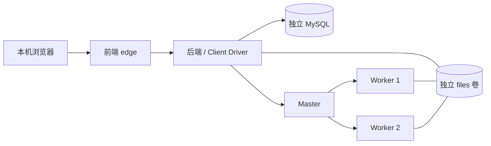

# 隔离集群演示环境

## 目的与边界

在同一台 WSL2/Docker 主机部署独立 MySQL、后端 Client Driver、前端、1 Master 和 2 Worker。使用独立数据库/文件/Worker 卷，不挂载主环境数据；后端/前端仅绑定 127.0.0.1 的动态端口。主环境保持原有 local 模式。本模板供受控毕设演示，不具备生产认证、HA 或跨物理机共享存储能力。

计算/数据库位于 internal 网络，后端另连 edge 网络供前端反向代理；前端只连接 edge。不要将 Master/Worker/MySQL 映射到外部网络。两 Worker 各声明 1 核/1024MiB，容器上限各2GiB；后端2GiB，Master512MiB，MySQL768MiB，前端512MiB，启动前应检查实际内存余量。创建要求 Windows 后备盘与 Linux 各至少8GiB可用空间，此值不是运行期间无限容量保证。



## 创建与运行

在仓库根目录使用已有 Docker 和依赖缓存，先构建候选镜像。命令不更新主镜像标签；执行前主环境应空闲。外层命令给出有限时间，构建失败需先查看日志，不得把失败当作部署完成。

```sh
timeout 600s docker build -f infrastructure/backend.Dockerfile -t spark-dq-backend:cluster-ui .
timeout 600s docker build -f infrastructure/frontend.Dockerfile -t spark-dq-frontend:cluster-ui .
timeout 600s docker build -f infrastructure/cluster-worker.Dockerfile -t spark-dq-worker:cluster-ui .
```

后端构建依赖已打包 JAR；全量构建可按主 README 的 Maven 流程先完成。Worker 基于锁定摘要的官方 Spark 3.5.8 镜像。后端 Java 是 PID1；不在容器内再套超时进程。

Windows 可用随交付提供的 `SparkDQ-runtime.ps1 -Action capacity -RequiredFreeBytes 8589934592` 获取后备盘容量，将 JSON 写入工作目录并传给 WSL 工具。不要以 Linux 虚拟盘剩余空间代替 Windows 后备盘。以下容量文件为示例路径，实际须使用刚获取的结果：

```sh
python3 infrastructure/cluster_lab.py create --output "$PWD/.runtime/my-new-demo" --host-capacity /mnt/c/path/to/capacity.json
python3 infrastructure/cluster_lab.py serve --output "$PWD/.runtime/my-new-demo" --seconds 3600
```

create 只接受不存在的 `.runtime` 子目录；检查主任务空闲后，生成随机项目名及私有密码并锁定候选镜像 SHA。私有目录700、`.env`600，不打印密码，不将其提交或交付。serve 为有期限前台控制进程；可由隐藏的非交互宿主进程持有。成功后输出实际 URL、项目和到期时间。停止后使用同一目录再次 serve，持久化卷沿用，动态 URL 可能变化。每次均从 status 读取地址，不能沿用旧端口。

```sh
python3 infrastructure/cluster_lab.py status --output "$PWD/.runtime/my-new-demo"
python3 infrastructure/cluster_lab.py stop --output "$PWD/.runtime/my-new-demo"
```

serve 支持60..7200秒，到期最多再等待350秒让已有任务结束，然后停止自有容器；不删除卷。stop 在有活动任务时拒绝，不能作为强制取消入口。并发 serve 由文件锁拒绝；PID、启动时钟、脚本路径及对应目录共同校验后才发送信号。配置/私有环境文件摘要变化或容器/网络/卷归属不符时停止操作。环境变量中的同名项目/镜像/密码覆盖被清除，Compose 显式指定随机项目名。

## 有限故障演示

只在本工具创建且当前空闲的演示环境内执行。以下操作暂停自有 Master 最多60秒，期间可从网页提交合成数据检测、取消并观察门禁；不用于主环境。

```sh
python3 infrastructure/cluster_lab.py outage --output "$PWD/.runtime/my-new-demo" --seconds 60
```

工具拒绝接管已经暂停的 Master；正常结束、异常或信号处理后在 finally 恢复节点并写入事件回执。进程被 SIGKILL 或宿主机断电无法执行 finally，恢复时应先通过状态和自有标签确认具体容器，再处理；不要全局 unpause/prune。前端显示“正在停止/暂时无法确认资源状态”，新检测/复检/治理暂停提交；全节点核对完成后才显示取消终态。

## 状态接口与前端

`GET /api/execution/status` 返回 mode（local/standalone）、cleanupPending 和 acceptingTasks。此接口不含连接地址、配置指纹或追溯编号；前端每3秒同步，用于状态提示和按钮禁用。后端原有准入校验仍是最终裁决，前端不是安全边界；状态获取失败显示待确认，不伪造资源已释放。

任务详情展示本地/集群/未记录，附执行追溯编号折叠区。历史 CLEAR 仅描述结束时的核对；当前内存中的失败核对不能被旧 CLEAR 覆盖。无效回执不展示作业身份。图表组件自己管理实例创建、重绘和卸载，不跨任务复用已销毁实例。

## 验证与数据保护

```sh
timeout 60s python3 -m unittest discover -s tests -p 'test_*.py'
```

Node 原生测试位于 `frontend/tests/*.test.mjs`，可在锁定 Node 容器内执行；Java全量使用已有Maven流程。本阶段真实结果见开发日志和交付 JSON，不以单元测试代替集群端到端结果。

停止/到期保留所有数据。工具没有删除卷、全局清理、远程推送或替换主部署的入口。若 Docker 地址池不足，先只读检查自有且已空闲的历史网络；不得全局 prune。更新镜像建议新建隔离环境；本阶段因额度中断后实验会话已到期，停机核验后仅更新 frontend SHA，私有旧控制文件保存在 revision 子目录，数据卷未变。该次维护过程已记录，不提供未经验证的在线热更新入口。

## 指定候选镜像、独立网段与重启地址（2026-10-20）

create新增--backend-image/--frontend-image/--worker-image，只允许本地可inspect的镜像引用并冻结完整ID；旧项目仍使用其created.json中的ID，不更新旧标签或控制文件。新项目扫描Docker IPAM与主机路由，配置独立default/edge两个非重叠/28网段，避免默认地址池耗尽；不删除旧网络。参考[候选验收复现](header-service-acceptance.md)。

serve将启动stdout/stderr写入私有startup-*.log，通用错误不输出凭证。status仅在控制进程身份吻合且运行时重新观察端口；端口不可观察则移除旧URL，返回addressObservation=UNAVAILABLE。OBSERVED只表示当前映射已观察，不能替代健康检查。整套或单服务重启均可能改端口。

## 隔离任务预算（2026-10-20）

create可选--task-timeout-seconds，接受5..300秒整数，默认300；预算作为固定字符串写入新项目Compose并纳入摘要，元数据记录taskTimeoutSeconds。其他操作拒绝此参数；旧项目仍按既有控制文件加载，不能热改预算。本参数供独立故障实验，不修改主环境；实际60秒超时/清理/复检证据见[验收说明](cluster-timeout.md)。
