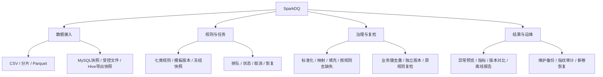
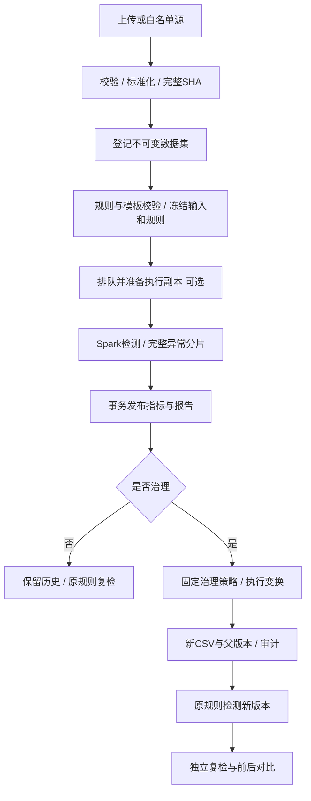
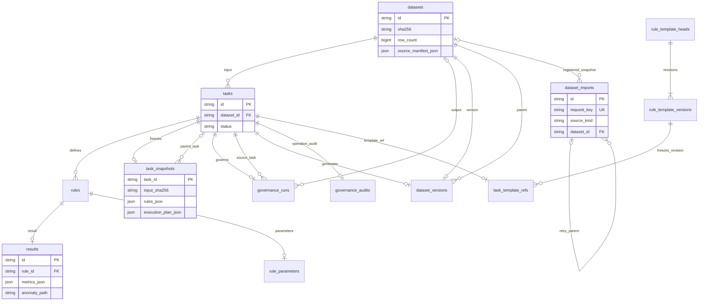
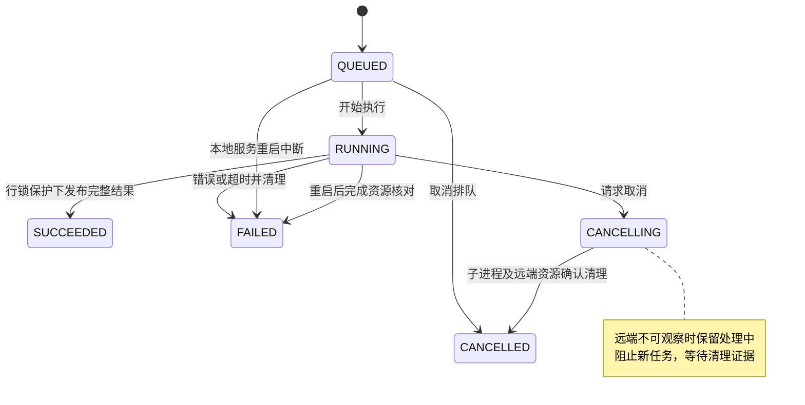
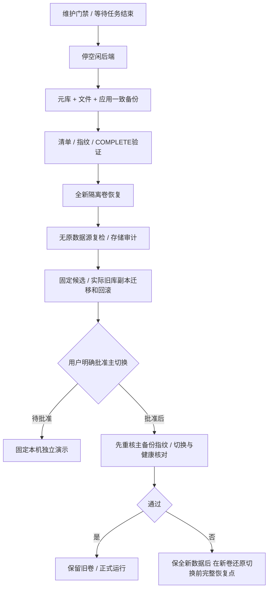

# SparkDQ 毕业设计最终交付手册

正式题目：《基于Spark的大规模数据质量检测与治理系统的设计与实现》。本资料解释已经实现和实际验收的系统，不替代学校正式任务书，也不代写论文。源码、阶段报告、实验原文和SHA清单共同构成证据链。

## 1. 使用入口与版本边界

独立演示固定地址 **http://127.0.0.1:15174**，API为 **http://127.0.0.1:18081/api**。它使用全新独立卷和最终候选，主环境原15173/18080及原数据卷未切换。演示不是公网服务，没有多租户认证。当前显示已有MySQL/Hive冻结快照和验收历史；不配置原业务库及Catalog，仍可复检。新增业务MySQL源须管理员按白名单配置，不能把历史快照误称为当前实时连接。

最终二进制身份、提交、测试和恢复点以SparkDQ-T11-manifest.json为准。T10完整回归/恢复/实际主库迁移/当前JAR双Worker证据见release-audit-t10.md。T11补查发现分片合并入口需复用同一流式读取保护；只改变CsvParts生产类，保留旧候选JAR并逐类比较证明其他生产class与Engine字节未变，再运行受影响分片完整闭环和最终常规回归，不把旧性能重跑凑数。

## 2. 固定演示：导入→检测→治理→独立复检

1. 打开固定地址，在“上传CSV”选择demo/orders.csv（交付目录附同一字节样本）。数据是14行合成订单，含NULL、空格、重复、异常金额和FD冲突，不含真实个人信息。
2. 选择刚导入的数据集。默认缺失/重复规则可直接执行；完整演示在“高级检测规则与模板”选择“毕业设计固定演示规则”，包含MISSING(note)、DUPLICATE(id)、IQR(amount,k=1.5)、FD(code→category)。模板对应demo/rules.json。
3. 创建检测并等待“已完成”，查看各规则指标和异常。IQR显示精确Q1/Q3/围栏；FD显示全部冲突参与行，不标认哪一行是错误来源。
4. 展开“生成新的治理版本并自动复检”，将note缺失填“待核实”，按id去重；对应demo/governance.json。输出是12行独立版本，原14行原文仍可下载。
5. 选择新版本，查看父版本和生成任务；按原规则独立复检并读取HTML/JSON报告。指标可跨规则重叠，不能相加当不同异常记录数；填充值只是测试策略，不声称恢复真实缺失值。
6. 可上传demo/typed.parquet体验原生Parquet。受控百万行、MySQL/Hive快照及取消/中断任务在保存的验收历史中可查看；有界预览每格256字符，完整原始数据/异常仍保留。

典型错误：字段名须英文字母开头且唯一；普通上传超过20MiB拒绝；原生Parquet浮点/时间戳/嵌套和含CR文本不支持；源未配置时不提供任意连接输入。任务运行中可取消，等待“已取消”，不能仅凭点击认定计算已停止。接口响应不明时先刷新历史确认，MySQL/Parquet重试使用同一导入键处理幂等，不盲目重复创建。

## 3. 稳定启动、停止与故障恢复

Windows在项目目录执行：

```powershell
wsl.exe -u root -e python3 /home/sparkdq/projects/spark-dq/infrastructure/demo.py start
wsl.exe -u root -e python3 /home/sparkdq/projects/spark-dq/infrastructure/demo.py status
wsl.exe -u root -e python3 /home/sparkdq/projects/spark-dq/infrastructure/demo.py stop
```

start复用已验证的独立卷及固定端口，检查JAR，不重建镜像/重置数据库；stop遇到进行中任务会要求先在页面取消，保留数据和卷。私有.runtime/demo-current.json定位这台机器的演示目录，不能复制其中.env到公开交付。首次重新建立演示需验证备份和本地镜像，再用demo.py prepare --backup <已验证备份> --frontend <固定镜像ID>；已有演示时拒绝覆盖。不是自动启动主项目的dev.sh up，也没有新增开机自动化或公网端口。

演示配额：后端2CPU/3GiB（服务堆512MiB、Spark子进程堆1GiB），元库1CPU/768MiB，前端0.5CPU/256MiB。运行前确认WSL至少4GiB可用内存、Linux及Windows后备盘至少8GiB空闲。后台WSL/Docker必须在运行，浏览器报错先执行status并检查Docker健康；不要靠删卷解决。后端意外中断，本地未完成任务在重启后标FAILED（取消中任务完成取消）；远端需确认原应用已清理后才允许新任务。重试创建新任务，保留失败记录。

备份采用maintenance.py先阻止写入、排空并停止空闲后端，再由storage.py保存SQL/文件/应用及清单；离线audit要求后端停止。恢复先验证清单，再创建全新卷并核对快照/规则/文件完整性，不需要原MySQL业务源或Hive Catalog在线。副本恢复成功不等于可以任意切换主环境；主切换仍需明确批准及最新恢复点。

## 4. 架构与数据模型

浏览器负责输入、状态和图表；Spring Boot负责规则验证、不可变快照、队列和事务登记；Spark负责分布式DataFrame计算及完整异常写出；MySQL保存元数据而不装载完整原始大表，文件卷保存原文/副本/结果。故障时不把文件存在当事务已成功，也不发布部分异常为成功结果。单人本机项目将源白名单和运维权限留在服务端，页面不接收密码/SQL/JDBC。

以下7图另存docs/diagrams/*.mmd，可由支持Mermaid的Markdown编辑器导出SVG/PDF。ER图的flyway_schema_history属于迁移工具元数据，未接业务关系；其余13张业务表如图。规则模板的复合版本键、任务快照、来源清单和父版本关系共同实现可追溯性。

### 01-总体架构

```mermaid
flowchart TB
 B[浏览器 Vue3 / ECharts] --> A[Spring Boot REST API]
 A --> V[输入验证 / 白名单 / 维护门禁]
 V --> Q[单任务执行器 + 最多8排队]
 A <--> M[(MySQL 元数据库)]
 Q --> S[Spark 3.5.8 Engine]
 S --> L[local 本机计算]
 S -.功能兼容已验证.-> C[同机 Master + 双 Worker]
 A <--> F[(不可变CSV / 输入副本 / 异常 / 审计文件)]
 S <--> F
 A --> R[离线HTML / JSON报告]
 X[只读业务MySQL白名单] --> I[有界一致快照]
 I --> F
 H[真实Hive Catalog / 嵌入式Derby] --> E[管理员固定表有界导出]
 E --> V
```



### 02-功能结构



### 03-技术路线


### 04-处理流程



### 05-数据库ER



### 06-任务状态



### 07-恢复与发布



## 5. 数据契约与独立版本

|来源|正式入口和实际限制|验收边界|
|---|---|---|
|普通CSV|UTF-8/RFC4180，单文件20MiB；表头最多100列/每名64字符；每格65536 UTF-16字符|不另设统一百万行上限，容量与实际完成规模是不同概念|
|CSV分片|2..16份，字段及顺序完全相同，原总量及合并CSV均20MiB|原文件按序保留，完整指纹；T11补齐分片解析前保护|
|原生Parquet|原20MiB、规范CSV20MiB、100列、百万行；严格类型转换|支持文本、布尔、整数、精确decimal、1582-10-15起日期；浮点/时间戳/嵌套/CR文本拒绝|
|MySQL业务快照|只读账号、白名单表/字段、InnoDB一致快照；默认20MiB/百万行/60秒|不是元数据库直连，也不是任意SQL服务；完整源变化与冻结规则验证在T1/T6/T10|
|受控预置CSV|只读目录固定别名与完整SHA；64MiB/百万行|实际百万→50万完整产品闭环通过；不承诺500万产品输入|
|Hive最小接入|真实Hive SerDe表+Catalog；管理员固定表最多100行导出后受控登记|实测14行、嵌入式Derby；非独立Metastore/任意实时表/分区表服务|

规范CSV以保留标记\N表示NULL，空字符串和纯空格不同；字面文本\N不能被无歧义表示，MySQL/Parquet转换对不代表NULL的同名文本会拒绝。引号、逗号、中文与多行字段按契约保留。T6修复Engine对治理CSV目录的记录分隔符检查，拒绝空目录/混合分隔符。

任务保存输入SHA、语义版本csv-v2、规范规则及可选执行副本计划/清单SHA；修改模板不改变历史规则。治理是标准化→同时值映射→填充→按MISSING规则去缺失→业务键去重，再检测新版本；不会原地更新源。默认去重以完整行字典序/NULL最前选保留记录；V4可指定最多5级文本/精确数值/日期优先级，最终仍以完整行排序打破并列。文件行序可能变化，应比较完整多重集而非CSV字节相等；原文下载仍按原SHA验证。

## 6. 算法定义、Spark实现与代价

**精确重复。** Engine.java按原始业务键groupBy/count求重复组数G、参与行数D、多余行数D-G；NULL键照常分组。异常用按键分区的count窗口标记__dq_group_size，保留全部原字段和多重性。不做字符串拼接、近似去重或仅返回“额外副本”。分组和窗口涉及shuffle/排序，内存受组基数、行宽和倾斜影响；不能简单承诺常数内存或无溢写。

**IQR。** IqrDetection.java只接受不自动trim/不允许指数、最多28位整数/10位小数的文本，再无损cast为Decimal(38,10)。合法数值n<4时INSUFFICIENT_DATA，无围栏、不当正常；n≥4时按升序x，位置h=(n-1)p，Q(p)=x_floor(h)+(h-floor(h))×(x_ceil(h)-x_floor(h))，p=0.25/0.75。IQR=Q3-Q1，L=Q1-k×IQR，U=Q3+k×IQR，严格x<L或x>U异常，k∈(0,10]最多4位小数。IQR=0仍计算并标ZERO_IQR。Spark全局orderBy+zipWithIndex只collect最多4个秩点，Driver用BigDecimal插值和比较，避免围栏的decimal精度缩减；缓存随后unpersist。不是把全表collect到Driver，也不是近似percentile。排序总体O(n log n)，缓存/网络总体随n及分区增长；Driver数值点O(1)，分区索引元数据随分区数增长。

**FD。** FdDetection.java验证配置的X→Y，X/Y各1..16个互不重叠字段，原始文本元组比较。任一字段NULL/空串/纯ASCII空格则跳过；groupBy(X).countDistinct(struct(Y))>1为冲突组，再left_semi join回全部合格参与行。保持重复记录，不投票推断错误来源，不自动修正。原因跳过计数可重叠，不能相加。哈希聚合期望近线性，但distinct与join存在shuffle和排序退化，最坏受O(n log n)、高基数/热点和行宽影响，状态可能随不同元组数增长；未做Driver全量collect。

**其他规则。** MISSING分别统计NULL、空串、纯空格；TYPE支持INTEGER/DECIMAL/DATE，RANGE为包含边界，REGEX为整字段匹配。空白按规则语义跳过，非法数值与超精度域另列。不能把未配置的字段视作合格，不能把不同规则异常数相加为不同问题行数。

正确性是“实现结果符合独立定义”，识别效果是“预测符合可信标签”。T9真实字段上的人工注入：缺失60/60命中；IQR TP40/FP487/FN0（Precision0.075901、Recall1、F1 0.141093）；这些FP只表示未注入，原始年龄是否业务错误未知。构造的month→season在24处修改后标全部45,231参与行；参与标签precision1、修改来源precision约0.000531，两者不是同一任务。T5历史偏态误报99/96/96、30%污染零召回、轻微偏移漏检、FD参与与修改标签差别全部保留，不能为美化指标改算法。

## 7. 主要API与调用约定

以下路径均相对/api；接口没有接受密码/JDBC/任意SQL的公共请求字段。GET页面读取，POST创建/取消，PUT修改模板，DELETE模板为归档并保留旧版本。

|方法/路径|用途和关键参数|
|---|---|
|GET /health|健康状态|
|POST /datasets|multipart file普通CSV，200返回数据集|
|POST /datasets/csv-parts|multipart files按提交顺序注册分片|
|GET /datasets/page?q=&page=1&pageSize=20|有界列表；pageSize最多100|
|GET /datasets/{id}、/download、/sources/{ordinal}/download|详情/规范版本/已保存原文|
|GET /datasets/{id}/tasks|当前独立版本的任务和生成历史|
|GET /controlled-files；POST /controlled-files/{id}/register|仅服务端固定别名，不传路径或正文|
|GET /mysql-sources；POST /mysql-imports|sourceId+columns及X-Import-Key(UUID)，202异步|
|GET /mysql-imports/page、/{id}；POST /{id}/cancel|导入状态/历史/取消|
|POST /imports；GET /imports/page、/{id}；POST /{id}/cancel、/{id}/retry|Parquet异步导入；X-Import-Key；multipart file|
|POST /tasks|datasetId+rules，或templateId+templateRevision；200任务|
|GET /tasks/page、/{id}；POST /{id}/cancel|任务分页/完整快照/取消|
|POST /tasks/{id}/govern|dropMissing/deduplicate/fills/normalizations/mappings/deduplicationOrder|
|POST /tasks/{id}/rerun|空对象复检固定输入规则；可指定新的datasetId|
|GET /tasks/{id}/rules/{rule}/preview|最多50行/每格256字符，完整异常文件不裁剪|
|GET /tasks/{id}/report、/report.html|JSON与离线HTML，?download=true下载|
|GET/POST /rule-templates；GET/PUT/DELETE /{id}；GET /{id}/versions|模板不可变修订和乐观revision校验|

提交示例见demo/rules.json。可选executionInput={"format":"CSV"或"PARQUET","partitions":1..16}冻结执行副本；默认CSV_SINGLE，不能拿执行副本256MiB预算绕过原始登记限制。HTTP400为输入/源白名单错误，404不存在，409状态/版本/维护忙冲突，413普通上传体积，429受控登记并发，503维护暂停写入。异步任务的202/200是受理，不是计算成功；以最终status和已发布结果为准。内部维护路由另需服务器私有Key，不应由页面操作或公开写进示例。

## 8. 实验材料、复现与证据索引

- T6：MySQL浏览器完整闭环、错误/取消/重启；修复治理目录读取，Java普通195等只属于该阶段。
- T7：受控百万行60,728,899字节→治理50万25,364,453字节→复检/报告/无源恢复，完整流式参考；不是性能协议。
- T8：真实Hive表、持久Metastore第二进程读取、14行全部多重集、正式IQR/FD/复检/来源页面。
- T9：UCI Bank Marketing，作者Moro/Rita/Cortez、DOI10.24432/C5K306、CC BY4.0；保留原始45,211行、全部原文SHA、转换说明与逐行注入。y是订阅标签而非质量真值。完整表格、原数据卡、4组PNG/SVG/PDF和CSV在docs/paper-data；报告public-data-experiments.md给出独立参考与复现。
- T4/T5历史：旧d9aeac JAR，每模式每规模1次预热+3次正式；20万/100万/500万。500万local中位61.588秒，同机双Worker106.844秒；不作加速或新JAR性能保证。内存是memory.current离散采样峰，CPU累计采样下界；local只Driver、集群包含Master/Driver/双Worker，资源配额不同。shuffle/spill完整表见T9资料，样本n=3不作显著性推断。
- T10：最终常规Java213+独立真实JDBC10、Node21、Python224；百万和各源统一闭环/全新恢复/实际旧主库225数据集完整指纹保留/V6迁移/旧镜像回滚；f400 JAR同机双Worker实际两Worker执行、取消/中断/超时清理。失败与补完审计记录均保留。
- T11：最终清单另列分片入口补充、最终常规回归、固定演示、最终应用备份恢复和二进制差异核对；不能把T10回归累加成T11单次通过。

复现需固定源码、JAR、镜像、输入SHA、规则、资源配额和协议；先检查宿主与WSL容量，使用全新.runtime目录，不覆盖旧数据。普通完整回归入口为离线Maven package（Java17 Spark模块参数沿用infrastructure/algorithm_experiments.py的MODULES）、镜像内node --test、python3 -m unittest discover -s tests -p 'test_*.py'。本机的固定Maven镜像/cache已验证；新机器首次允许依赖下载后才能-o离线。不要在有任务的主项目执行会重建服务的旧e2e脚本。

## 9. 最终能力矩阵与尚待确认

|状态|项目|
|---|---|
|已经实现并有当前候选实际验收|CSV/分片/Parquet/MySQL快照，七类规则，模板冻结，取消/恢复，治理/独立版本/复检/报告，受控百万闭环及源断开恢复|
|受限真实验收|Hive固定表14行/嵌入式Derby/管理员有界快照；同机双Worker功能；固定本机单人演示|
|仅引用历史正式实验|T4旧JAR20万/100万/500万性能及T5合成识别效果；T9资料新整理未重跑这些组|
|尚未验证/未来扩展|跨物理机、HA/生产并发、多租户公网鉴权、任意在线Hive/独立Metastore/分区表、500万产品完整业务/千万或TB输入、所有64MiB最宽形状组合|
|需要单独明确批准|实际主部署切换；当前提供稳定独立演示与可审计恢复/回滚方案|
|需要学校材料确认|学校任务书/开题原文、指定数据源/部署硬指标、论文格式与答辩评分点；不能用目前总任务书代替|

学习源码建议：App.vue及各Panel→DatasetApi/MysqlImports→Rules/RuleTemplates→Tasks/ExecutionInputs/ExecutionReceipts→Engine/IqrDetection/FdDetection→GovernancePolicies/Reports→storage/maintenance。面试应能解释冻结规则为何独立于模板、FD为何标全组、IQR为何不能用double/近似分位数替代、取消为何要等资源证据、为何数据与文件需一起备份，以及同机集群为何可能更慢。

## 10. 最终实际收据与审查补充

最终常规回归Java后端171+Engine43=214、Node21、Python224全部通过。T10真实JDBC10项单独引用，本阶段未重跑，不叠加为一次全量。最终生产类只有CsvParts.class与T10不同，其余生产class及Engine逐字节相同；最终分片真实6任务、6类非法输入与3源分片原文哈希/CSV对照/两执行副本/治理/复检均通过。固定演示3任务，四类规则全部指标和完整异常独立核对；最终镜像另有全新卷实际Spark复检与存储审计通过，恢复点 `87aa5edbbbf4e4f78409516a408e881cf6b18adfe99944720e38f7e47e3d5620`。

最终应用JAR `860558dc9a3edfe57f387cb665e31d33ed720432445c2b43d8e2181019b2b707`；Engine `f4006c52ef1689db7fde83deb9a9f3f673434b95b5803357f7ef636ad8819633`。后端 `sha256:5582efaa92c4e7809f054bc9a25e0fcf44093668e8c3b44d46f0a6d54a29f91d`，前端 `sha256:a718f4705a7d5c48a8db38e0ce0ed2bb41e53f9e131a0adaa3e6988e1651cf07`。最终恢复源镜像与恢复基础镜像不同，实际只读/app的JAR已校验，不能只用基础镜像ID标注应用。恢复audit issues为空；3个失败分片登记目录作为unregisteredSourceDirectory警告保留，没有发布为数据集，也未删除历史。

七份Mermaid图源已按源码/外键校对，未宣称经过外部渲染器自动验图；三组架构/功能/数据流另有已逐图目视核对的PNG/SVG/PDF，位于docs/diagrams/rendered。纸用实验图表维持T9独立数据/版本。

本机离线构建的实际流程已整理为 `python3 infrastructure/build_candidate.py`：固定Maven/Node镜像、2CPU/4GiB Maven容器、既有maven-cache、Java17 Spark模块参数，运行常规测试及生成候选镜像/身份日志，不启动或替换主服务。首次新机器需先按固定pom下载依赖再使用离线模式；不要在运行任务时重建演示。
