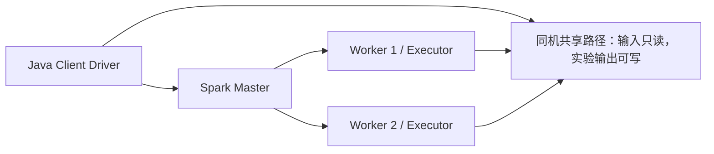

# 同机多容器 Spark Standalone 最小验证

本阶段使用现有Java/Spark Engine，在独立Docker内部网络建立1 Master、2 Worker及独立client Driver，验证真实跨JVM执行和现有结果口径。它是可复现的离线实验入口，不是网页任务的集群调度切换；主服务仍运行原本的本地模式。



## 已实现与配置边界

Engine原先固定Driver为127.0.0.1，远程Executor无法回连。本阶段新增DriverNetwork：默认local[2]和显式local模式保持回环绑定；仅在受信进程环境SPARK_MASTER=spark://host:port时，要求管理员显式提供可回连的SPARK_DQ_DRIVER_HOST。拒绝缺失/回环/非法Driver地址及未知master协议；HTTP任务JSON不能设置网络地址。集群Driver只在实验容器内绑定0.0.0.0，实验不发布主机端口。

ClusterEvidence是显式spark.extraListeners启用的Java SparkListener，从实际TaskEnd事件按Executor聚合成功/失败任务数和主机名，在ApplicationEnd输出有界JSON；不保存数据值，不默认加入主API结果。最多64个Executor，超过预算或同ID主机漂移标记truncated并拒绝验收。仅见到Worker注册、或看到两个容器，不算双节点执行证据。

检测/治理验收要求两个已知远程Worker都有成功任务；复检验收要求实际远程参与者属于这两个Worker，保留观测到的节点数量。调度不保证每个小作业都由全部Worker完成任务；本阶段不把复检正确性、双节点参与和负载均衡混为同一判据。

## 运行与复现

先按项目构建流程完成Maven package。使用本项目已有Docker权限，预先拉取已固定的官方Java/Scala镜像（无需PySpark）：

```bash
timeout 600s docker pull apache/spark@sha256:8cd61978c71aafcd61ac37fcdbbca2ad774396407c9498c79a2afdfc57142783
timeout 2100s python3 infrastructure/standalone_trial.py --output .runtime/standalone-new --host-capacity /绝对路径/host-capacity.json --rows 10000
```

host-capacity.json来自Windows现有host.ps1 capacity，必须报告实际WSL承载盘已知且至少8GiB余量，Linux也至少8GiB。输出必须是项目.runtime内全新目录，不覆盖或自动恢复既有失败目录。行数100..20000，输入仍受20MiB限制。主系统有活动任务/导入时初始准入拒绝；完成前后对照主业务/文件/镜像及包括导入的业务指纹。

镜像来源为Apache官方apache/spark:3.5.8-scala2.12-java17-ubuntu的amd64清单摘要；实际观测Spark3.5.8、Hadoop3.3.4、Temurin17.0.17。主系统Java17.0.18保持。镜像内运行spark-submit、Java Driver和Java Executor，没有改用PySpark；Python只负责容器编排与独立预期验证。

每轮生成固定种子一万行、8字段、空值/空字符串/空格/业务键重复及类型异常，先在同镜像local[2]建立独立预期对照，再由现有PreparedInput生成4份Parquet输入、绑定清单SHA。远程检测使用8输入分区及2 shuffle分区，七规则统计和完整异常多重集均与本地一致。治理使用既有v4标准化/映射/填充/业务优先级去重，逐操作审计及治理CSV由独立预期校验；再对实际治理CSV复检。

还实际取消已分配双Executor的Driver，要求两个Worker进程中的Executor均退出且无成功结果；随后复检验证资源能重新使用。错误输入清单SHA必须拒绝并清理Executor。实验容器逐个绑定所属标签，清理只停止本轮对象；保留日志、输入、输出、失败诊断和容器，不删除主库或用户卷。终止信号会触发控制器清理，守护进程另有1800秒外层期限，单个作业300秒。

## 资源与日志

| 角色 | cgroup上限 | JVM/调度 |
| --- | --- | --- |
| Master | 0.5CPU / 512MiB | daemon256MiB |
| 每个Worker | 1CPU / 2GiB | daemon256MiB，申报1核/1024MiB，每Executor1核/768MiB |
| Driver | 2CPU / 2GiB | 1GiB堆 |

进程上限512、根文件系统只读、cap-drop ALL、no-new-privileges，/tmp为768MiB有界临时文件系统；合成输入只读挂载，只有本轮输出可写。Worker执行器工作日志保存在实验输出目录，Driver/Master/Worker容器日志另行保存。网络是本轮独立Docker internal网络，无主机端口发布，未接入主应用网络。

success结果以verified.json及逐例验证JSON为准，不根据日志中的“已启动”推断成功。Executor事件使用Spark配置的worker1/worker2主机名，并另存其容器ID/实际IP映射。每个作业记录实际参与节点，失败不补造证据。

## 当前未完成

仍在同一台WSL主机上。共享bind路径只验证同机共享文件可见性，不是HDFS/S3/跨物理机共享存储。没有上线集群任务API、数据库中的集群作业ID/状态协调、远程取消/重启恢复或多租户鉴权；不要只改主后端SPARK_MASTER就当作生产集群部署完成。

本轮是正确性、进程清理和网络最小验证，没有重复条件下的公平性能基准，也不宣称提速、跨主机高可用或TB级能力。Driver记录的CPU/峰值内存不是全体Executor的总量；local与cluster容器总资源分配不同，不用于计算加速比。

下一步按实际需要设计在线作业提交/持久化映射、共享存储和集群生命周期协调，再做更大规模及跨主机验证。实验仅供受控本机网络使用；未建立面向不可信网络的生产认证配置。

## 官方依据

- [Spark3.5.8 Standalone部署及同机测试](https://dlcdn.apache.org/spark/docs/3.5.8/spark-standalone.html)
- [Driver回连与集群概念](https://dlcdn.apache.org/spark/docs/3.5.8/cluster-overview.html)
- [spark.extraListeners及Driver网络配置](https://spark.apache.org/docs/3.5.8/configuration.html)
- [Apache Spark官方镜像](https://hub.docker.com/r/apache/spark)

结束时停止且保留本次拥有的实验容器和日志，并仅移除经过标签所有权与无连接核对的本次空临时网络，避免地址池累积。拒绝移除其他会话或仍有连接的网络。
